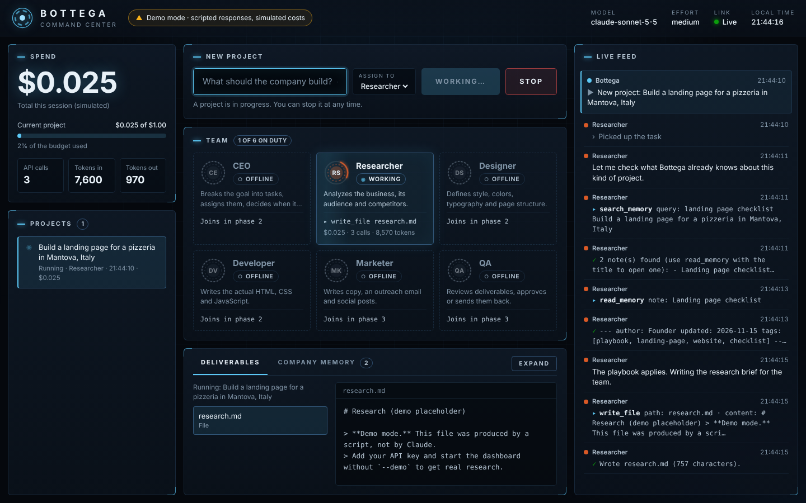
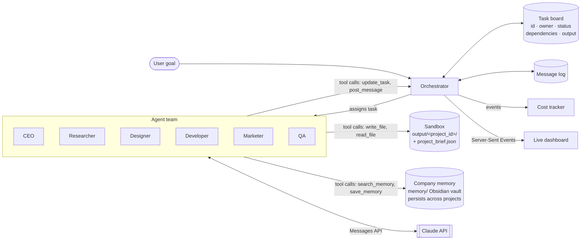
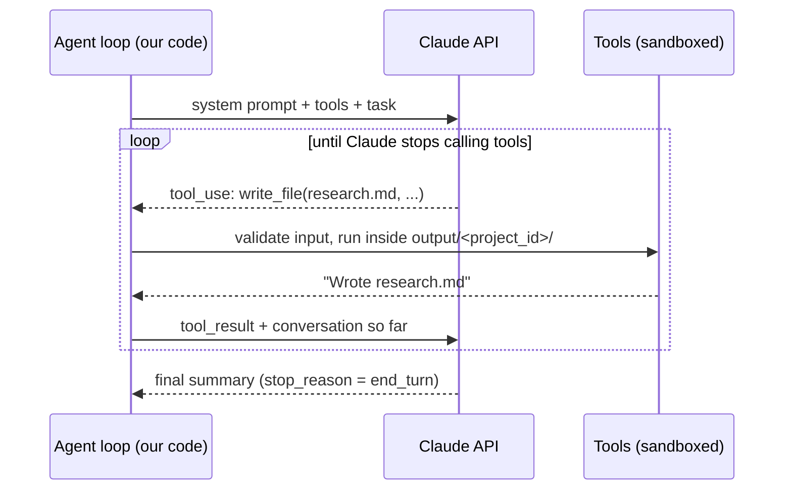
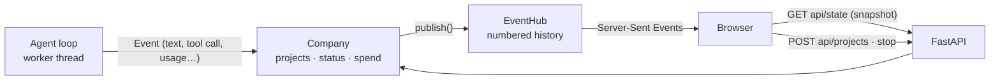

# Bottega 🎨🤖

> *In Renaissance Italy, a **bottega** was a master's workshop: apprentices and specialists each worked on part of a piece (grinding pigments, painting backgrounds, finishing details) until the work was done. Bottega is that workshop, staffed by AI agents.*

**A company run entirely by AI agents.** Give Bottega a goal, for example *"Build a landing page for a pizzeria in Mantova, Italy"*, and a team of specialized Claude agents (CEO, Researcher, Designer, Developer, Marketer, QA) splits it into tasks, collaborates through a shared task board and delivers real output: research, a design system, working HTML/CSS/JS, marketing copy.

> 🚧 **Status: work in progress.** One agent (the Researcher) works end to end, with company memory and a live command center. The other five agents join in the next phases. See the [roadmap](#roadmap).

<!-- TODO: replace with a screen recording (GIF) of a real run -->


*The command center in demo mode: one agent on duty, five seats waiting for the next phases.*

---

## Architecture



**Key idea:** agents never call each other directly. They only interact with shared state (the task board, the message log, the project files) through **tools**. The orchestrator decides who runs next. That keeps every agent simple and the whole system observable and testable.

### How a single agent works (implemented in phase 1)



An agent = **system prompt + allowed tools + this loop**. All six roles share one `Agent` class (`bottega/agents/base.py`); a role is just a prompt file plus a list of tool names (`bottega/agents/roles.py`).

### The command center

`python -m bottega serve` starts a local web dashboard: give the company a goal, watch each agent work, read what it delivers, follow the cost, and stop a project at any time.



- **Events are signals, the snapshot is truth.** Each event adds a line to the live feed and tells the page "something changed"; the page then re-fetches one JSON snapshot. Totals are never rebuilt from events in the browser, so they cannot drift.
- **Threads meet async in one place.** Agents run in worker threads (the agent loop blocks on the network), the web server is async. `EventHub.publish()` bridges the two with `loop.call_soon_threadsafe`.
- **Nothing is lost on reconnect.** Events are numbered; the browser says which one it saw last and receives the rest. If a proxy blocks the stream, the page falls back to polling.
- **Demo mode** (`--demo`) replaces the Claude API with a scripted client and runs the real agent loop, tools and dashboard on top of it: no key, no cost, same result every time.

### Company memory 🧠

Bottega has two kinds of memory:

| | Project memory | Company memory |
|---|---|---|
| Where | `output/<project_id>/` | `memory/` |
| Lifetime | one project | forever, shared by all projects |
| Contains | deliverables (research, HTML, copy) | client notes, playbooks, lessons learned |

`memory/` is an **[Obsidian](https://obsidian.md) vault**: plain Markdown notes with YAML frontmatter (`author`, `updated`, `tags`) and `[[wikilinks]]`. Agents call `search_memory` / `read_memory` before they start and `save_memory` when they learn something reusable. You can open the same folder in Obsidian and watch the company's knowledge grow in the graph view.

### Project layout

```
bottega/
├── bottega/
│   ├── cli.py              # `python -m bottega ...`
│   ├── config.py           # typed settings from .env
│   ├── company.py          # Company: owns projects, runs agents in the background
│   ├── costs.py            # pricing table + per-agent cost tracking
│   ├── demo.py             # scripted stand-in for the Claude API (--demo)
│   ├── errors.py           # exceptions -> messages a human can act on
│   ├── events.py           # events emitted by agents (CLI and dashboard listen)
│   ├── sandbox.py          # Workspace: confines every path to one folder
│   ├── memory/vault.py     # company memory: Obsidian vault, keyword search
│   ├── agents/
│   │   ├── base.py         # the tool-use loop
│   │   ├── roles.py        # role registry (prompt + allowed tools)
│   │   └── prompts/        # one markdown system prompt per role
│   ├── tools/
│   │   ├── base.py         # Tool type + input validation
│   │   ├── files.py        # write_file, read_file, list_files
│   │   └── memory_tools.py # search_memory, read_memory, save_memory
│   └── web/
│       ├── hub.py          # EventHub: thread-safe pub/sub with replay
│       ├── server.py       # FastAPI: JSON API + Server-Sent Events
│       └── static/         # the dashboard: index.html, style.css, app.js
├── memory/                 # the company's Obsidian vault (committed)
└── tests/                  # offline tests using a fake Claude client
```

---

## How to run

Requires **Python 3.11+** and an [Anthropic API key](https://platform.claude.com/settings/keys).

```bash
git clone https://github.com/<you>/bottega.git
cd bottega
python -m venv .venv && source .venv/bin/activate   # Windows: .venv\Scripts\activate
pip install -r requirements-dev.txt

cp .env.example .env        # then put your key in .env (never commit it)
```

**Open the command center:**

```bash
python -m bottega serve --demo    # explore the dashboard: no API key, nothing is billed
python -m bottega serve           # the real thing (needs your key in .env)
```

Then open <http://localhost:8000>. The dashboard has no login, so by default it only listens on your own computer.

**Or run one agent in the terminal:**

```bash
python -m bottega solo researcher "Build a landing page for a pizzeria in Mantova, Italy"
```

Output is written to `output/<project_id>/`, and reusable knowledge to `memory/`.

**Browse the company memory:** in Obsidian choose *Open folder as vault* and select the `memory/` folder.

**Run the tests** (offline, free, no API key needed):

```bash
pytest
```

### Configuration

All settings live in `.env` (see [`.env.example`](.env.example)):

| Variable | Default | Meaning |
|---|---|---|
| `BOTTEGA_MODEL` | `claude-sonnet-5-5` | Model used by all agents |
| `BOTTEGA_EFFORT` | `medium` | Thinking depth: `low` … `max` (higher = better and pricier) |
| `BOTTEGA_MAX_TOKENS` | `32000` | Max output tokens per API call |
| `BOTTEGA_MAX_TURNS` | `25` | Max API calls per agent per task |
| `BOTTEGA_MAX_COST_USD` | `1.00` | A project stops by itself once it has spent this much |
| `BOTTEGA_OUTPUT_DIR` | `output` | Where projects are written |
| `BOTTEGA_MEMORY_DIR` | `memory` | Company memory (Obsidian vault) |
| `BOTTEGA_REFUSAL_FALLBACK` | `true` | If the model declines, retry server-side on a fallback model |

---

## Example output

<!-- TODO: paste real output from your first run -->
```
Project 20261115-213000-build-a-landing-page-for-a-pizzeria-in-m  |  model claude-sonnet-5-5  |  effort medium

▶ [Researcher] Researcher starts working
🔧 [Researcher] write_file({"path": "research.md", "content": "# Research: Pizzeria in Mantova... [5210 chars]"})
  ↳ [Researcher] ok: Wrote research.md (5210 characters).
💬 [Researcher] ...summary...
✔ [Researcher] Researcher finished (end_turn, $0.0xxx)
```

---

## Design decisions

- **Hand-written agent loop** instead of an SDK helper, so every step can emit an event (live dashboard) and record cost (budget limit).
- **Sandbox in the tool layer.** Model output is untrusted input. Every path is resolved and checked to stay inside `output/<project_id>/`, which blocks `../` and symlink escapes.
- **Tool errors go back to the model** (`is_error: true`) instead of crashing, so agents can fix their own mistakes.
- **Streaming + eager tool-input streaming**, so long outputs (whole HTML files) don't hit HTTP timeouts. Because the API then skips input validation, we validate every tool input ourselves.
- **Prompt caching** on the system prompt + tools, which are resent on every turn of the loop.
- **Memory as Markdown files, not a database**, so humans (in Obsidian) and agents (through tools) share one source of truth. Search is plain keyword scoring: no extra dependencies and easy to debug. Semantic search with embeddings could replace it later behind the same `search()` function.
- **Cost priced by `response.model`**, not the configured model, because a refusal fallback may have served the call. Unknown models are priced conservatively.
- **Limits are checked between model calls.** The budget and the Stop button take effect before the *next* call, after the tools of the current one have run, so a file an agent was writing is never lost.
- **Server-Sent Events instead of WebSockets.** Updates only flow from server to browser, and SSE is plain HTTP with automatic reconnection built into the browser.
- **No frontend framework, no build step.** The dashboard is three static files. Everything agents write is inserted with `textContent`, never `innerHTML`, so model output cannot inject markup into the page.
- **The core knows nothing about the web.** `Company` reports progress through a `publish` function it is handed; the server passes its event hub, the tests pass `list.append`.

---

## Roadmap

- [x] **Phase 1:** project structure, config, base `Agent`, sandboxed file tools, cost tracking, one agent (Researcher)
- [x] **Phase 1.5:** company memory (Obsidian vault + search/read/save tools)
- [x] **Command center** (moved up from phase 4): FastAPI + Server-Sent Events dashboard, demo mode, Stop button, $1 budget per project
- [ ] **Phase 2:** orchestrator, task board, message log, `project_brief.json`, CEO delegating to 2 agents
- [ ] **Phase 3:** all 6 agents + QA revision loop (max 2 revisions)
- [ ] **Phase 4:** dashboard for the whole team: task board (kanban) and agent-to-agent messages
- [ ] **Phase 5:** retries, project history that survives a restart, orchestrator tests

---

## What I learned

<!-- Write this section yourself, in your own words, as you build each phase.
     Admissions readers value specific, honest reflection over polish. Prompts:
     - What surprised you about how tool use actually works?
     - A bug you hit and how you tracked it down
     - Why the sandbox matters (what could go wrong without it?)
     - What you'd do differently / what you'd build next -->

- *Phase 1:* …

---

## License

[MIT](LICENSE)
