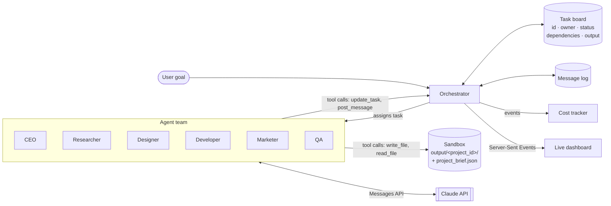
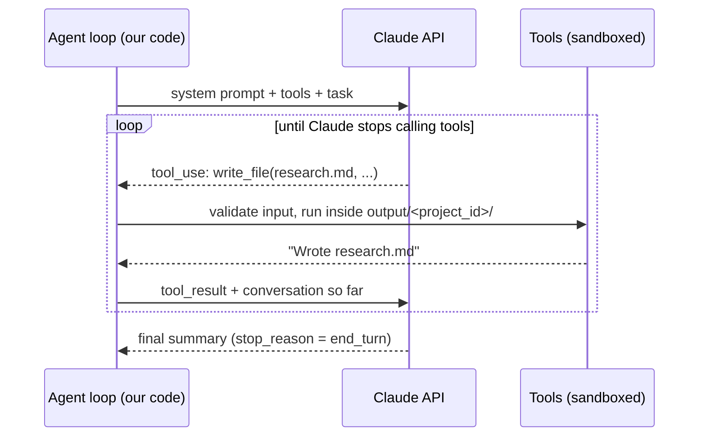

# AgentCo 🏢🤖

**A company run entirely by AI agents.** Give AgentCo a goal, for example *"Build a landing page for a pizzeria in Mantova, Italy"*, and a team of specialized Claude agents (CEO, Researcher, Designer, Developer, Marketer, QA) splits it into tasks, collaborates through a shared task board and delivers real output: research, a design system, working HTML/CSS/JS, marketing copy.

> 🚧 **Status: Phase 1 of 5.** A single agent (the Researcher) works end to end. See the [roadmap](#roadmap).

<!-- TODO: replace with a real recording once the dashboard exists (phase 4) -->


---

## Architecture



**Key idea:** agents never call each other directly. They only interact with shared state (the task board, the message log, the project files) through **tools**. The orchestrator decides who runs next. That keeps every agent simple and the whole system observable and testable.

### How a single agent works (implemented in phase 1)



An agent = **system prompt + allowed tools + this loop**. All six roles share one `Agent` class (`agentco/agents/base.py`); a role is just a prompt file plus a list of tool names (`agentco/agents/roles.py`).

### Project layout

```
agentco/
├── agentco/
│   ├── cli.py              # `python -m agentco ...`
│   ├── config.py           # typed settings from .env
│   ├── costs.py            # pricing table + per-agent cost tracking
│   ├── events.py           # events emitted by agents (CLI now, dashboard later)
│   ├── agents/
│   │   ├── base.py         # the tool-use loop
│   │   ├── roles.py        # role registry (prompt + allowed tools)
│   │   └── prompts/        # one markdown system prompt per role
│   └── tools/
│       ├── base.py         # Tool type + input validation
│       ├── workspace.py    # sandbox confined to output/<project_id>/
│       └── files.py        # write_file, read_file, list_files
└── tests/                  # offline tests using a fake Claude client
```

---

## How to run

Requires **Python 3.11+** and an [Anthropic API key](https://platform.claude.com/settings/keys).

```bash
git clone https://github.com/<you>/agentco.git
cd agentco
python -m venv .venv && source .venv/bin/activate   # Windows: .venv\Scripts\activate
pip install -r requirements-dev.txt

cp .env.example .env        # then put your key in .env (never commit it)
```

**Run one agent (phase 1):**

```bash
python -m agentco solo researcher "Build a landing page for a pizzeria in Mantova, Italy"
```

Output is written to `output/<project_id>/`.

**Run the tests** (offline, free, no API key needed):

```bash
pytest
```

### Configuration

All settings live in `.env` (see [`.env.example`](.env.example)):

| Variable | Default | Meaning |
|---|---|---|
| `AGENTCO_MODEL` | `claude-sonnet-5-5` | Model used by all agents |
| `AGENTCO_EFFORT` | `medium` | Thinking depth: `low` … `max` (higher = better and pricier) |
| `AGENTCO_MAX_TOKENS` | `32000` | Max output tokens per API call |
| `AGENTCO_MAX_TURNS` | `25` | Max API calls per agent per task |
| `AGENTCO_OUTPUT_DIR` | `output` | Where projects are written |
| `AGENTCO_REFUSAL_FALLBACK` | `true` | If the model declines, retry server-side on a fallback model |

---

## Example output

<!-- TODO: paste real output from your first run -->
```
Project 20261115-213000-build-a-landing-page-for-a-pizzeria-in-m  |  model claude-sonnet-5-5  |  effort medium

▶ [Researcher] Researcher starts working
🔧 [Researcher] write_file({"path": "research.md", "content": "# Research: Pizzeria in Mantova... [5210 chars]"})
  ↳ [Researcher] ok: Wrote research.md (5210 characters).
💬 [Researcher] ...summary...
✔ [Researcher] Researcher finished (end_turn, $0.0xxx)
```

---

## Design decisions

- **Hand-written agent loop** instead of an SDK helper, so every step can emit an event (live dashboard) and record cost (budget limit).
- **Sandbox in the tool layer.** Model output is untrusted input. Every path is resolved and checked to stay inside `output/<project_id>/`, which blocks `../` and symlink escapes.
- **Tool errors go back to the model** (`is_error: true`) instead of crashing, so agents can fix their own mistakes.
- **Streaming + eager tool-input streaming**, so long outputs (whole HTML files) don't hit HTTP timeouts. Because the API then skips input validation, we validate every tool input ourselves.
- **Prompt caching** on the system prompt + tools, which are resent on every turn of the loop.
- **Cost priced by `response.model`**, not the configured model, because a refusal fallback may have served the call. Unknown models are priced conservatively.

---

## Roadmap

- [x] **Phase 1:** project structure, config, base `Agent`, sandboxed file tools, cost tracking, one agent (Researcher)
- [ ] **Phase 2:** orchestrator, task board, message log, `project_brief.json`, CEO delegating to 2 agents
- [ ] **Phase 3:** all 6 agents + QA revision loop (max 2 revisions)
- [ ] **Phase 4:** FastAPI + Server-Sent Events live dashboard
- [ ] **Phase 5:** error handling, retries, $1 cost limit per run, orchestrator tests

---

## What I learned

<!-- Write this section yourself, in your own words, as you build each phase.
     Admissions readers value specific, honest reflection over polish. Prompts:
     - What surprised you about how tool use actually works?
     - A bug you hit and how you tracked it down
     - Why the sandbox matters (what could go wrong without it?)
     - What you'd do differently / what you'd build next -->

- *Phase 1:* …

---

## License

[MIT](LICENSE)
