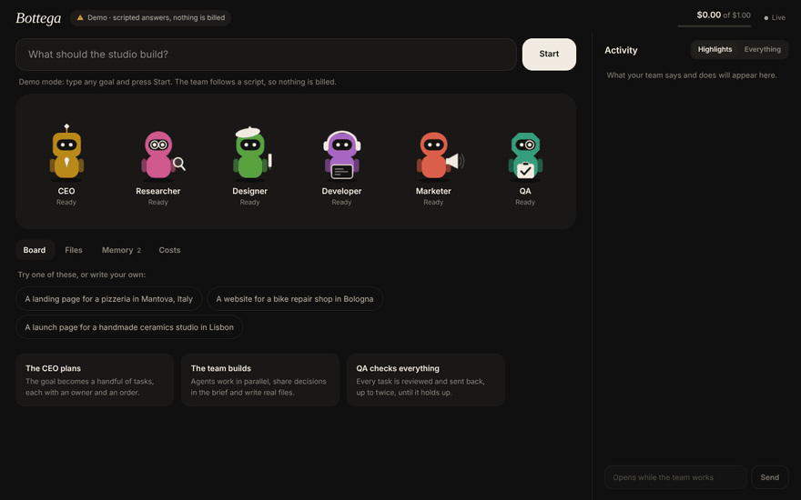
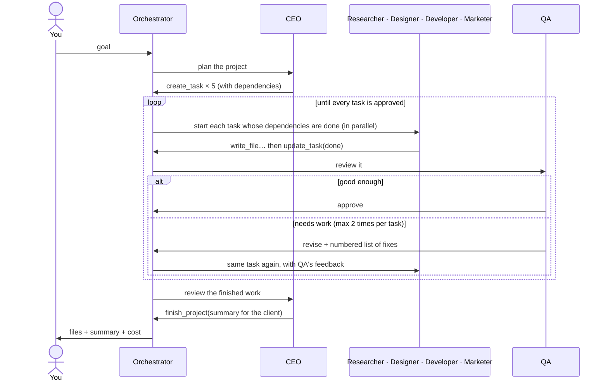
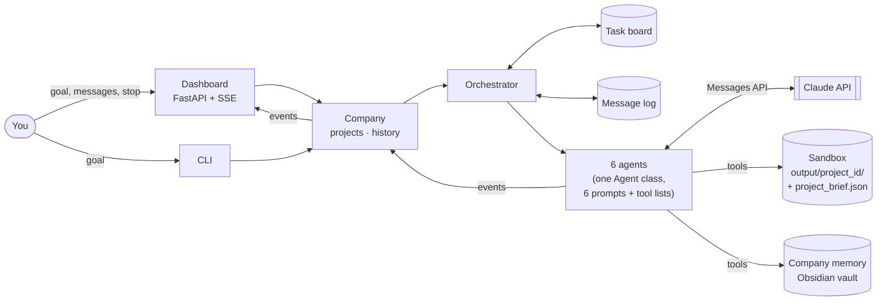
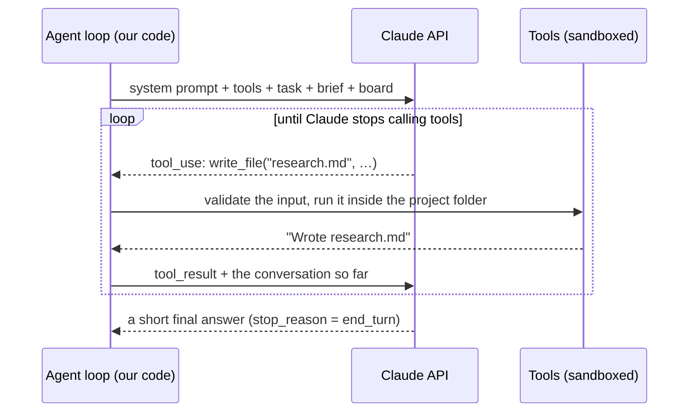

# Bottega

[](https://github.com/abejit-singh/bottega/actions/workflows/tests.yml)


> *In Renaissance Italy, a **bottega** was a master's workshop: apprentices and specialists each worked on part of a piece (grinding pigments, painting backgrounds, finishing details) until the work was done. Bottega is that workshop, staffed by AI agents.*

**A small studio run entirely by AI agents built on the Claude API.** Give it a goal, such as *"A landing page for a pizzeria in Mantova, Italy"*. A team of six Claude agents plans the work, splits it up, builds it in parallel, reviews every piece and delivers real files: research, a design system, a working website, website copy, an outreach email and social posts.



*Demo mode: the agents follow a script, so this recording costs nothing. With an API key the same screen shows Claude doing the real work.*

---

## The team

| Agent | What it does | What it may touch |
|---|---|---|
| **CEO** | Breaks the goal into tasks, assigns each one, and closes the project | Creates tasks, writes the brief, posts messages. **Never writes deliverables.** |
| **Researcher** | Studies the business, its audience and its competitors → `research.md` | Writes files, saves to company memory |
| **Designer** | Defines colors, typography and page structure → `design.md` | Writes files, writes design tokens to the brief |
| **Developer** | Builds the website → `site/index.html`, `site/style.css` | Writes files |
| **Marketer** | Writes the copy, an outreach email and three social posts | Writes files |
| **QA** | Reviews every finished task, then approves it or sends it back with exact fixes | Reads files, gives verdicts. **Cannot write files.** |

Each agent is one class (`Agent`) with a different system prompt and a different list of allowed tools (`bottega/agents/roles.py`). QA cannot write files on purpose: a reviewer that could quietly fix the work would hide problems instead of reporting them.

## How a project runs



**Agents never call each other.** They coordinate only through shared state, using tools:

- **Task board**: what needs doing, who owns it, what it depends on, its status and its result.
- **Message log**: short notes between agents (and from you, while a project runs).
- **Project brief** (`project_brief.json`): decisions everyone must apply the same way, such as the audience, the tone of voice and the design tokens. Every agent sees it at the top of every task.
- **Company memory** (`memory/`): notes that survive across projects (see below).

The orchestrator decides who works when, by reading the board. It is plain, predictable code: **the models make the judgement calls** (what to build, whether it is good enough), **the code owns the control flow** (order, limits, retries, budget). That split keeps cost and behavior bounded, whatever a model answers.

## Architecture



### Inside one agent



Before every call the loop checks the **Stop button** and the **budget**, and after every call it records the **cost**.

### The dashboard

`bottega serve` opens a local page where you can:

- **see the agents**: each has a character, a color and a speech bubble that says what it is doing ("Writing design.md", "Sending it back"), and its tool moves while it works;
- **give orders**: start a project, message the team while it works, stop it;
- **follow the work** on a kanban board (To do, In progress, In review, Done), with QA's feedback on every card;
- **open the results**: the generated website in a live preview at desktop or phone width, every document rendered and readable (placeholders to replace are highlighted, color codes get a swatch), every memory note, and a zip with all the files;
- **watch the money**: total cost, the budget meter, and the cost of each agent;
- **know if Claude is ready**: at startup the page checks the API key, the model and every agent's setup, and refuses to start a project that would only fail.

The page gets live updates through **Server-Sent Events**. Each event adds a line to the activity feed and tells the page that something changed. The page then fetches one JSON snapshot, which is the single source of truth, so the numbers can never drift.

### Company memory

| | Project memory | Company memory |
|---|---|---|
| Where | `output/<project_id>/` | `memory/` |
| Lifetime | one project | forever, shared by all projects |
| Contains | deliverables, brief, board | client notes, playbooks, lessons learned |

`memory/` is an **[Obsidian](https://obsidian.md) vault**: plain Markdown notes with frontmatter (`author`, `updated`, `tags`) and `[[wikilinks]]`. Agents call `search_memory` before they start and `save_memory` when they learn something reusable. Open the same folder in Obsidian and you can watch the company's knowledge grow in the graph view.

---

## How to run

Requires **Python 3.11+**. For real runs you also need an [Anthropic API key](https://platform.claude.com/settings/keys).

```bash
git clone https://github.com/abejit-singh/bottega.git
cd bottega
python -m venv .venv && source .venv/bin/activate   # Windows: .venv\Scripts\activate
pip install -e ".[dev]"     # installs Bottega and adds the `bottega` command
cp .env.example .env        # then put your key in .env (it is git-ignored)
```

Run the commands below from the project folder: projects are saved in `output/` and the company memory lives in `memory/`. `python -m bottega …` works the same as `bottega …`.

**Try it for free first.** Demo mode replaces Claude with a script but runs everything else for real: the orchestrator, the board, the tools, the QA loop and the dashboard.

```bash
bottega serve --demo     # then open http://localhost:8000
```

**Check that everything is ready** before the first real run. It is free: it uses the token-counting endpoint, which generates nothing.

```bash
bottega check            # API key, model, and every agent's prompt and tools
bottega check --live     # plus one tiny real request (under a cent)
```

**Run the real team:**

```bash
bottega serve                                                  # dashboard
bottega run "A landing page for a pizzeria in Mantova, Italy"  # terminal
bottega solo researcher "…"                                    # one agent alone, to tune a prompt
```

Each project is saved in `output/<project_id>/`. Open `site/index.html` in a browser to see the website the team built.

**Run the tests and the linter** (offline, free, no API key needed):

```bash
pytest
ruff check bottega tests
```

### Configuration

All settings live in `.env` (see [`.env.example`](.env.example)):

| Variable | Default | Meaning |
|---|---|---|
| `BOTTEGA_MODEL` | `claude-sonnet-5-5` | Model used by every agent |
| `BOTTEGA_EFFORT` | `medium` | How hard the model thinks: `low` … `max` (higher is better and costs more) |
| `BOTTEGA_MAX_COST_USD` | `1.00` | A project stops by itself once it has spent this much |
| `BOTTEGA_MAX_REVISIONS` | `2` | How many times QA may send one task back |
| `BOTTEGA_MAX_PARALLEL` | `3` | How many agents may work at the same time |
| `BOTTEGA_MAX_TURNS` | `25` | Max API calls per agent per task |
| `BOTTEGA_MAX_TOKENS` | `32000` | Max output tokens per API call |
| `BOTTEGA_API_RETRIES` | `4` | Automatic retries for rate limits and server errors |
| `BOTTEGA_TASK_RETRIES` | `1` | Extra attempts for a task that failed with a temporary error |
| `BOTTEGA_OUTPUT_DIR` | `output` | Where projects are written |
| `BOTTEGA_MEMORY_DIR` | `memory` | Company memory (Obsidian vault) |
| `BOTTEGA_REFUSAL_FALLBACK` | `true` | If the model declines a request, retry it server-side on a fallback model |

---

## Example output

From `bottega run --demo "A landing page for a pizzeria in Mantova, Italy"`. In demo mode the files are placeholders and the costs are simulated, but the flow is the real one, including QA sending the website back once:

```
[CEO] 📌 new task: T1 Research the business and its audience
[CEO] 📌 new task: T2 Design system for the landing page
[CEO] 📌 new task: T3 Website copy
[CEO] 📌 new task: T4 Build the landing page
[CEO] 📌 new task: T5 Outreach email and social posts
[CEO] 💬 to all: Kickoff! Research goes first. Design and copy can then run side by side. …
[Researcher] ▶ started: T1 Research the business and its audience
[Researcher] 📄 Wrote research.md (778 characters).
[QA] ✅ approved: T1 Research the business and its audience
[Designer] ▶ started: T2 Design system for the landing page
[Marketer] ▶ started: T3 Website copy
…
[QA] ↩ sent back: T4 Build the landing page
      feedback: 1. site/index.html: the <html> tag has no lang attribute; add lang="en".
2. site/index.html: the hero button has no href; link it to the contact section.
[Developer] ▶ started: T4 Build the landing page
[Developer] 📄 Wrote site/index.html (1183 characters).
[QA] ✅ approved: T4 Build the landing page
[Bottega] 🏁 Project done ($0.4478, 8 files)

Task board:
  T1 [done] Research the business and its audience (researcher)
  T2 [done] Design system for the landing page (designer)
  T3 [done] Website copy (marketer)
  T4 [done, revised 1x] Build the landing page (developer)
  T5 [done] Outreach email and social posts (marketer)
```

---

## Project layout

```
bottega/
├── bottega/
│   ├── cli.py              # bottega serve | run | check | solo
│   ├── config.py           # typed settings from .env
│   ├── team.py             # the six seats: names, titles, who can own tasks
│   ├── company.py          # Company: runs projects in the background, keeps history
│   ├── orchestrator.py     # plan → work (parallel + QA loop) → wrap up
│   ├── project/
│   │   ├── board.py        # TaskBoard: dependencies, review gate, revision limit
│   │   ├── messages.py     # MessageLog
│   │   ├── brief.py        # project_brief.json
│   │   └── state.py        # everything the team shares, saved to disk
│   ├── agents/
│   │   ├── base.py         # Agent: the tool-use loop, stop flag, budget check
│   │   ├── roles.py        # which tools each role may use
│   │   └── prompts/        # one Markdown system prompt per role
│   ├── tools/
│   │   ├── base.py         # Tool type + input validation
│   │   ├── files.py        # write_file, read_file, list_files
│   │   ├── memory_tools.py # search_memory, read_memory, save_memory
│   │   └── board_tools.py  # create_task, update_task, review_task, post_message, …
│   ├── memory/vault.py     # company memory: Obsidian vault, keyword search
│   ├── sandbox.py          # Workspace: confines every path to one folder
│   ├── costs.py            # pricing table + cost per agent
│   ├── errors.py           # which errors stop a project, which are worth a retry
│   ├── check.py            # preflight check: key, model, every agent's prompt and tools
│   ├── demo.py             # scripted stand-in for the Claude API (--demo, tests)
│   └── web/
│       ├── server.py       # FastAPI: JSON API, SSE, sandboxed previews
│       ├── hub.py          # EventHub: thread-safe pub/sub with replay
│       └── static/         # the dashboard: index.html, style.css, app.js, markdown.js
├── memory/                 # the company's Obsidian vault
├── tests/                  # 112 offline tests, run on every push by GitHub Actions
└── docs/                   # screenshot and demo GIF
```

---

## Design decisions

- **The models judge, the code controls.** Planning and reviewing are left to Claude. Ordering, limits, retries and the budget are ordinary Python, so a confused model can't loop forever or overspend.
- **Coordination through shared state, not agent-to-agent calls.** Every agent reads the same board, brief and messages. Agents stay independent, and the whole project is observable and saved to disk.
- **The board enforces the rules.** Illegal moves are refused: handing in someone else's task, a third revision, a dependency on a task that doesn't exist. Because a task can only depend on tasks created before it, dependency cycles are impossible by construction.
- **Least privilege per role.** Each role gets only the tools its job needs, and the tools double-check that each agent acts only on its own task.
- **Parallel work with threads.** An agent spends almost all its time waiting for the API, which is exactly what threads are good at. Each role works on one task at a time.
- **Failures are contained.** A temporary error (network, rate limit) is retried. A task that keeps failing is marked failed, together with only the tasks that depend on it, and the rest of the project carries on. A wrong API key stops everything at once instead of failing six times.
- **Untrusted output stays untrusted.** Every path an agent writes goes through a sandbox that blocks `../` and symlink escapes. Agent text only reaches the dashboard through `textContent`, never as HTML. Generated websites are previewed under a `sandbox` Content-Security-Policy, so their scripts can't call the dashboard's API. Requests from other websites can't start projects.
- **Streaming, prompt caching and tool-input validation.** Long outputs (whole HTML files) stream, so they don't hit HTTP timeouts. The system prompt and tools are cached, because they are resent on every turn. Because tool inputs stream too, the API no longer validates them, so every input is checked in our code before a tool runs.
- **Cost priced by `response.model`.** A refusal fallback may answer on a different model; unknown models are priced conservatively.
- **A scripted client for demos and tests.** `DemoClient` plays all six agents. It powers `--demo` and most of the tests, which therefore exercise the real orchestrator, tools and agent loop, for free and the same way every time.
- **Check before you spend.** `bottega check` sends each agent's real system prompt and tools to the free token-counting endpoint, so a wrong key, a wrong model name or a broken tool definition shows up in seconds instead of halfway through a paid project.
- **A Markdown renderer that cannot be tricked.** Deliverables are written by a model, so the dashboard's small renderer builds every element with `textContent` and never uses `innerHTML`; only http(s) links become clickable.
- **No frontend framework, no build step.** The dashboard is four static files; the six characters are drawn with plain SVG shapes and animated with CSS.

## Tests

`pytest` runs 112 tests in about three seconds, with no network and no API key. GitHub Actions runs them, plus the linter, on Python 3.11, 3.12 and 3.13 for every push.

| File | What it covers |
|---|---|
| `test_orchestrator.py` | the whole team end to end: dependency order, the QA revision loop and its limit, the budget, the Stop button, retries, contained failures, a wrong API key |
| `test_board.py` | the board's rules, the message log, the brief, saving and loading |
| `test_board_tools.py` | each teamwork tool, and which role may use what |
| `test_agent.py` | the tool-use loop: tool errors, truncated output, turn limit, refusals, cancel, budget |
| `test_company.py` | project lifecycle, live snapshot, history after a restart |
| `test_web.py` | the HTTP API, sandboxed previews, the zip download, cross-site protection, the event hub |
| `test_check.py` | the preflight check: missing key, rejected key, every agent's setup, the live request |
| `test_workspace.py`, `test_memory.py`, `test_tools_and_costs.py` | sandbox escapes, memory search, input validation, pricing |

## Limitations

- The Researcher has **no internet access**. It works from the model's general knowledge and is told to mark assumptions and never invent facts, prices or reviews.
- **One project at a time**, and the dashboard has **no login**: it listens only on your own computer by default.
- Costs are **estimates** from a price table in `bottega/costs.py`. Keep it up to date with Anthropic's pricing page.
- Quality depends on the model and on the prompts in `bottega/agents/prompts/`. They are the easiest place to improve the studio.

---

## Lessons from the build

Real problems met while building Bottega, and what they taught:

- **Enforce the rules in code, not only in the prompt.** QA is told that on the final review it must approve. In the tests a reviewer that ignores this keeps answering "revise", and the board refuses the move. A model that doesn't follow an instruction can't break the workflow.
- **Passing tests are not the same as a working screen.** All the tests were green while the dashboard showed the word "null" on the board: `replaceChildren(null)` turns `null` into text. Only a screenshot caught it, so every interface change now gets looked at in a real browser.
- **Re-rendering can restart animations.** The board is rebuilt on every update. A fade-in on its cards made them flicker while the team worked, so elements that are re-created get no entry animation.
- **A good default has to keep updating.** The Files tab opened `project_brief.json` instead of the website, because the brief is written first and the first file won. Now the tab follows the most useful file until you pick one yourself.
- **Layers keep imports clean.** The memory needed the sandbox and the tools needed the memory, which made a circular import. Moving the sandbox into its own module, that depends on nothing, fixed it.
- **Threads and async need one bridge.** Agents run in threads while the web server is async. Events cross over in a single place (`EventHub.publish` with `call_soon_threadsafe`) instead of everywhere.
- **Stop between steps, never in the middle of one.** The Stop button and the budget are checked before each model call, so a file an agent was writing is never left half-written.
- **A scripted stand-in pays for itself.** Because the demo client plays all six agents, 112 tests exercise the real orchestrator in three seconds, for free. Most of the bugs they caught were in the plumbing, not in the model.

<!-- Add your own "What I learned" here, in your own words: what surprised you, a bug you
     tracked down yourself, what you would build next. Admissions readers look for your voice. -->

---

## License

[MIT](LICENSE)
